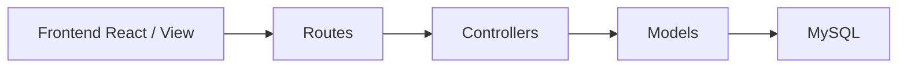

# Painel Selfit

Sistema interno para gerenciar unidades, TVs, equipamentos, câmeras, garantias e manutenções. A interface usa React/TypeScript; a API usa Node.js/Express e MySQL.

## Organização

```text
project_selfit/
├── Frontend/
│   ├── src/
│   │   ├── assets/              Logo e recursos importados pela interface
│   │   ├── components/          Componentes reutilizados entre telas
│   │   ├── contexts/            Providers e estado compartilhado
│   │   ├── hooks/               Hooks que consomem os contextos
│   │   ├── pages/               Telas completas do sistema
│   │   ├── services/            API, CEP e carregamento dos dados
│   │   ├── utils/               Datas, filtros, tipos e navegação
│   │   ├── App.tsx              Login, providers e seleção das telas
│   │   ├── main.tsx             Entrada do React
│   │   └── index.css            Estilos globais
│   ├── tests/                   Testes do frontend
│   ├── package.json             Dependências e comandos da interface
│   └── ...                      Vite, TypeScript, Tailwind e ESLint
├── Backend/
│   ├── src/
│   │   ├── config/              Ambiente, banco, segurança e montagem da API
│   │   ├── controllers/         Recebem HTTP, chamam models e devolvem respostas
│   │   ├── models/              Regras de negócio e acesso aos dados
│   │   │   ├── regras/          Validação e normalização de negócio
│   │   │   └── repositories/    Consultas SQL e persistência
│   │   ├── routes/              URLs, middlewares e validações de entrada
│   │   └── server.js            Inicialização e encerramento do servidor
│   ├── database/
│   │   ├── migrations/          Histórico de alterações do banco
│   │   └── seeds/               Dados de unidades para uso local
│   ├── scripts/                 Operação de banco, contas e homologação
│   ├── tests/                   Testes de models, segurança e MVC
│   ├── .env                     Ambiente principal, privado
│   ├── .env.homolog             Homologação, privada e isolada
│   └── package.json             Dependências e comandos da API
├── database/schemas/            Estruturas SQL de referência dos dois ambientes
├── docs/                        Operação, segurança e revisão técnica
├── scripts/                     Execução e empacotamento do sistema completo
├── backups/                     Backups privados locais, fora do Git
├── package.json                 Atalhos para frontend e backend
└── README.md
```

`node_modules`, `Frontend/dist` e `artifacts` são saídas locais/geradas. Não fazem parte da arquitetura do código. Não há Docker nem pasta `deploy/`.

## Frontend

- **pages:** telas acessadas pelo usuário, como `ConsultarPage.tsx` e `ManutencoesPage.tsx`.
- **components:** elementos reutilizáveis. `components/inventario/FormularioEquipamento.tsx` é usado nos cadastros; `ListaEquipamentos.tsx` reúne consulta, edição e remoção dos ativos.
- **contexts:** mantêm dados e estado compartilhado. `InventarioContext.tsx` carrega unidades/inventário; `ModuloContext.tsx` mantém o módulo selecionado; `ApiContext.tsx` disponibiliza o cliente da API.
- **hooks:** `useInventario`, `useModulo` e `useApi` permitem consumir os respectivos contextos sem repetir essa lógica nas telas.
- **services:** `api.ts` centraliza HTTP, token e expiração da sessão; `inventoryService.ts` converte os dados recebidos; `cepService.ts` consulta endereços. Chamadas externas ficam aqui.
- **utils:** regras auxiliares de datas, importação de unidades, filtros, tipos e metadados de navegação.
- **App.tsx:** conecta os providers, valida a sessão e decide qual tela exibir.

Foram mantidos `.tsx` e `.ts`, pois o projeto já utiliza TypeScript. A estrutura corresponde à organização solicitada sem converter a linguagem dos arquivos.

## Backend em MVC

Neste projeto, o **Model** reúne regras e persistência; os **Controllers** fazem a adaptação HTTP; a **View** é o frontend React separado. A API devolve JSON e não precisa de uma pasta de templates `views/`.



Exemplo de edição de equipamento:

1. A tela envia `PUT /api/equipamentos/TV:1`.
2. `routes/equipamentos.routes.js` aplica a validação e encaminha ao controller.
3. `controllers/equipamentos.controller.js` chama o model e prepara a resposta.
4. `models/equipamentos.model.js` verifica o módulo do item e a unidade de destino.
5. O repositório em `models/repositories/` executa o SQL parametrizado na tabela correta.

As rotas não executam SQL. Controllers não abrem conexões de banco. Models não acessam `req` ou `res`. `config/container.js` conecta models, repositórios e autenticação; `config/app.js` e `config/http.js` montam o Express. Essa separação também permite testar regras com repositórios em memória.

## Onde fazer manutenção

| Mudança | Arquivo/pasta |
| --- | --- |
| Tela ou formulário | `Frontend/src/pages/` ou `Frontend/src/components/` |
| Estado compartilhado | `Frontend/src/contexts/` |
| Consumo de contexto | `Frontend/src/hooks/` |
| Chamada da API ou integração externa | `Frontend/src/services/` |
| Filtros, datas e importação na interface | `Frontend/src/utils/` |
| URL ou middleware de endpoint | `Backend/src/routes/` |
| Corpo/resposta HTTP | `Backend/src/controllers/` |
| Fluxo e regra de negócio | `Backend/src/models/*.model.js` e `models/regras/` |
| Query SQL | `Backend/src/models/repositories/` |
| Ambiente ou conexão MySQL | `Backend/src/config/` |
| Estrutura do banco | Nova migration em `Backend/database/migrations/` |

Use nomes que expressem a responsabilidade: uma nova tela vai para `pages`, um hook recebe prefixo `use`, uma integração externa recebe nome de serviço e o backend usa os sufixos `.routes.js`, `.controller.js` e `.model.js`. Os comentários explicam decisões de integridade, transações, identificadores e seleção de ambiente.

## Ambientes e banco

Existem somente `Backend/.env` (principal) e `Backend/.env.homolog` (homologação). Os valores locais foram preservados e os arquivos receberam comentários. Ambos são privados, ignorados pelo Git e excluídos da distribuição. O frontend usa `/api` e não precisa de `.env`.

O principal é carregado por padrão. Os comandos `:homologacao` selecionam o arquivo de homologação explicitamente. `npm start` força o modo de produção usando o principal; revise os valores antes de executar no servidor. A configuração completa está em [EXECUCAO.md](docs/EXECUCAO.md).

Os schemas são `selfit_db` e `selfit_homolog`. As estruturas sem dados estão em [principal.sql](database/schemas/principal.sql) e [homologacao.sql](database/schemas/homologacao.sql). Esses snapshots servem para revisão. Instalações e atualizações usam migrations; não importe snapshots sobre uma base existente.

As sete migrations são necessárias: o Knex registra suas identidades em `knex_migrations` e confere esse histórico antes de atualizar. Os arquivos foram renomeados em português e numerados na ordem de execução. `Backend/knexfile.js` relaciona esses nomes às identidades antigas para preservar a compatibilidade com as bases existentes, sem alterar registros nem reaplicar migrations. Por isso, o status do Knex ainda pode mostrar os nomes históricos. Não remova esse mapeamento nem exclua arquivos já aplicados. As migrations não executam a cada inicialização; `api:migrate` executa somente as pendentes. A ordem é:

| Migration | Responsabilidade |
| --- | --- |
| `001_criar_tabelas_iniciais.js` | Cria as tabelas e os índices iniciais, sem cadastrar senhas. |
| `002_remover_campos_obsoletos_dos_equipamentos.js` | Remove campos do inventário antigo. |
| `003_separar_tvs_cameras_e_equipamentos.js` | Separa TVs e câmeras, preservando os vínculos das manutenções. |
| `004_adicionar_tipo_da_unidade.js` | Compatibiliza o tipo das unidades de bases antigas. |
| `005_validar_referencias_e_indexar_manutencoes.js` | Valida as referências e acrescenta o índice de manutenções. |
| `006_adicionar_serie_e_patrimonio_dos_ativos.js` | Adiciona série e patrimônio aos três módulos. |
| `007_preencher_identificadores_ausentes.js` | Define o texto padrão para identificadores ausentes. |

`backups/` contém `backup-principal.sql` e `backup-homologacao.sql`: uma cópia completa por ambiente. Os comandos substituem o arquivo correspondente somente após concluir o novo dump; uma falha preserva a cópia anterior. O acesso local de testes fica em `Backend/.admin-test-access.txt`, privado e fora do Git.

## Identificação dos ativos

TVs, equipamentos e câmeras possuem `numero_serie` e `numero_patrimonio`, disponíveis no cadastro, nas edições e nas informações da unidade. As buscas do inventário e de unidades também aceitam esses identificadores.

Ao lado do patrimônio, a opção **Não possui** desabilita o campo e envia `null` à API. O número de série continua disponível. Os campos aceitam até 100 caracteres como texto, preservando zeros à esquerda, letras e hífens. Valores são normalizados para maiúsculas. O backend grava **NÃO INFORMADO** no MySQL quando o identificador está vazio, nulo ou foi omitido no cadastro. Não foi criada uma nova obrigatoriedade para os identificadores.

`Frontend/src/components/inventario/CamposIdentificacao.tsx` compartilha os campos entre cadastro e edição. `Backend/src/models/regras/identificadores.js` centraliza a validação e o texto padrão. Em atualizações parciais, omitir um identificador preserva seu valor; enviar `null` o substitui por **NÃO INFORMADO**. As respostas da API continuam usando `null` para ausência, mantendo o checkbox e os clientes existentes compatíveis.

A migration `006_adicionar_serie_e_patrimonio_dos_ativos.js` acrescenta as colunas nas três tabelas. A seguinte, `007_preencher_identificadores_ausentes.js`, substitui apenas identificadores nulos/vazios pelo texto padrão e define o mesmo default no MySQL para inserções que omitem a coluna. Números existentes e datas de atualização são preservados. As migrations devem ser executadas nos dois ambientes antes de iniciar a nova API:

```sh
npm run api:migrate
npm run api:migrate:homologacao
```

Faça backup antes de atualizar. Reinicie as APIs e atualize o frontend após a mudança. O rollback desta migration preserva as colunas e seus valores para evitar perda de identificadores cadastrados.

## Instalação e desenvolvimento

Requisitos declarados: Node.js `>=22.12.0 <25`, npm e MySQL 8.0. Esta revisão utilizou Node.js 24.14.1. Na raiz:

```sh
npm --prefix Frontend ci
npm --prefix Backend ci
npm run api:migrate
npm run api:start
```

Em outro terminal:

```sh
npm run dev
```

O frontend atende em 5174 e encaminha `/api` para 3000. Para homologação, use `npm run api:start:homologacao` e `npm run dev:homologacao`; o proxy encaminha para 3001. Não sobrescreva os arquivos de ambiente existentes. Em outra instalação, crie-os conforme o guia de execução.

No PowerShell com bloqueio de scripts, use `npm.cmd` no lugar de `npm`, sem alterar a política da máquina.

## Validação

```sh
npm run check
npm run test:migrations
npm run test:migrations:homologacao
npm run test:integration
```

`check` executa lint, testes, TypeScript e build. Os testes de migrations copiam a base selecionada para um schema temporário, aplicam as migrations e comparam os registros. A integração usa outro schema temporário para testar login e operações dos três módulos. Somente os schemas criados pelos próprios testes são removidos; esses comandos precisam de uma conta de validação com permissão adequada.

Leia [AUDITORIA.md](docs/AUDITORIA.md) para as correções e limitações conhecidas, [SEGURANCA.md](docs/SEGURANCA.md) para as proteções e [EXECUCAO.md](docs/EXECUCAO.md) para uso no servidor.
