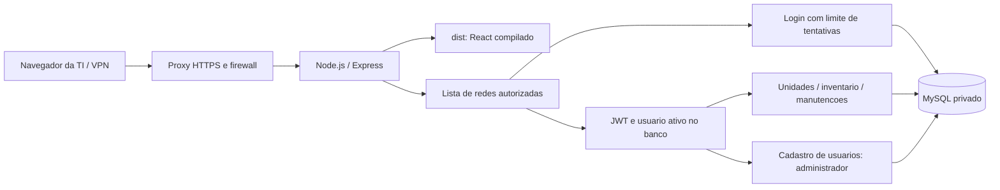

# Arquitetura do Painel Selfit

## Organizacao

- `src/main.tsx` e `src/app/App.tsx`: entrada React, validacao da sessao, login e navegacao.
- `src/pages/` e `src/components/`: telas e componentes compartilhados.
- `src/providers/`: estado de inventario e modulo selecionado.
- `src/services/api.ts`: requisicoes, JWT, timeout e encerramento da sessao apos 401.
- `src/services/inventory/`: tipos, filtros e normalizacao de planilhas.
- `api-selfit/src/app.js`: composicao HTTP, protecoes, API e frontend estatico.
- `api-selfit/src/server.js`: validacao do ambiente/schema, abertura da porta e encerramento das conexoes.
- `api-selfit/src/config/`: ambiente, conexao MySQL/TLS, CORS e parametros de execucao.
- `api-selfit/src/middleware/`: redes autorizadas, usuarios autorizados, JWT e administracao.
- `api-selfit/src/routes/`: SQL parametrizado e regras de cada operacao.
- `api-selfit/src/database/migrations/`: historico necessario para novas instalacoes e atualizacoes.
- `api-selfit/scripts/create-user.js`: provisionamento explicito, sem senha fixa ou sobrescrita de contas.
- `scripts/`: build do pacote, startup, selecao de ambiente, seed local e testes integrados.
- `tests/` e `api-selfit/tests/`: regras reais de inventario e protecao HTTP.

## Execucao

Desenvolvimento usa Vite em 5174 e API em 3000. O proxy `/api` do Vite encaminha para a API. Producao usa um processo Node para servir `dist/` e `/api`, evitando URLs de localhost no navegador remoto. As rotas antigas sem prefixo sao aliases da mesma API e passam pelas mesmas protecoes.

O servidor verifica acesso as seis tabelas principais antes de abrir a porta. Migrations sao executadas explicitamente antes de iniciar a nova versao, nunca automaticamente por cada replica. SIGTERM/SIGINT param o recebimento de requisicoes e encerram o pool em ate 25 segundos.

## Persistencia

`unidades` e `usuarios` possuem IDs inteiros; `tvs`, `equipamentos`, `cameras` e `manutencoes` usam IDs bigint. O contrato HTTP prefixa itens como `TV:1`, `CAMERA:1` e `EQUIPAMENTO:1`. Manutencoes apontam para `item_tipo` e `item_id`. Ativos usam exclusao logica (`deleted_at`); manutencoes e unidades podem ser removidas fisicamente conforme as regras atuais da API. As FKs impedem exclusao de unidade com ativos vinculados.

O nome historico `migrate.js` foi preservado para nao invalidar bases existentes. Em banco vazio as migrations de compatibilidade nao encontram tabelas antigas, e a migration inicial cria diretamente o schema atual. O teste integrado valida esse fluxo e a segunda execucao sem alteracoes.

## Limpeza

Foram removidos 23 arquivos nesta revisao: o reexport antigo `src/App.tsx`, o SQL manual que duplicava migrations e 21 scripts avulsos de ajuste, exclusao, auditoria e importacao pontual. A importacao suportada continua na interface e no endpoint autenticado de lote. Testes automatizados substituem verificacoes manuais repetidas. Exclusoes que ja existiam na arvore de trabalho antes desta revisao foram preservadas.

`node_modules/`, `dist/`, caches e ambientes reais nao entram no Git. `deploy-artifact/` e a imagem Docker levam apenas o runtime; o repositorio mantem fontes, documentacao, migrations e testes para permitir manutencao e reconstrucao.
